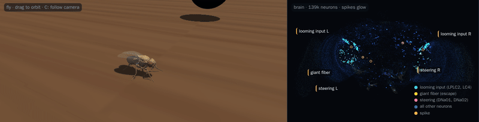

# Fly Brain Simulation

[](https://github.com/tac76/fly-brain-simulation/actions/workflows/ci.yml)

**A model of the real fruit fly brain decides how a physically simulated fly escapes a looming
threat.**



The brain is the full adult *Drosophila* connectome from [FlyWire](https://flywire.ai) (~139,000
neurons, ~15 million connections), simulated as spiking neurons with the published model of
Shiu et al. 2024. The body is NeuroMechFly, a physics model built from a 3D scan of a real fly.
A threat dives at the fly; what the fly does next comes out of the simulated brain.

## What is real and what is hand-built

Every 20 ms of simulated time:

| Step | What happens | Made by |
|---|---|---|
| 1. Eyes | How large and how fast-growing the threat looks to each eye becomes input for the looming-detector neurons (LPLC2, LC4) | hand-built encoding |
| 2. Brain | All ~139k neurons are simulated on the real wiring (leaky integrate-and-fire, Shiu et al. 2024). No behaviour is written by hand here | **connectome model** |
| 3. Read-out | Descending neurons for steering (DNa01/DNa02) and escape (giant fiber, DNp01) | connectome model |
| 4. Motor mapping | Left-vs-right steering activity becomes a turn, giant-fiber activity a speed-up | hand-built mapping |
| 5. Body | MuJoCo physics; the legs are moved by FlyGym's gait controller | physics + built-in gait |

Walking itself is a default: with a silent brain the fly walks straight at a constant drive. The
turn away and the speed-up come from the brain model's output. The brain model is not tuned;
only the hand-built encoding and mapping constants are, and how they were chosen is documented
in [docs/calibration.md](docs/calibration.md).

## Results

Measured against a run of the same scene with the brain switched off (three random seeds):

| Threat | Change of walking direction | Notes |
|---|---|---|
| from the left | 36–45° to the right (away) | giant fiber fires up to 250 Hz |
| from the right | 54–57° to the left (away) | turns to the left are larger: the wiring is not symmetric |
| head-on | −26° to +21°, side varies with the seed | both eyes inhibit each other's steering |
| slow, far away | 0° | no input, no reaction |

Limits: the speed-up is small (4–10 % longer path), and a real fly would usually jump away.
This fly only walks.

## Try it

**Gallery, no install:** **[tac76.github.io/fly-brain-simulation](https://tac76.github.io/fly-brain-simulation/)** (replays of
recorded runs; the editor needs the local server below). Locally:

```bash
cd viewer && npm ci && npm run dev        # http://localhost:5173
```

**Editor** (place your own threat, press Apply, watch what the brain does):

```bash
uv sync
uv run flybrain download-data             # ~135 MB FlyWire data, CC BY-NC 4.0
(cd viewer && npm ci && npm run build)
uv run flybrain serve                     # http://127.0.0.1:8770/?editor
```

A 3 s scene takes about 2 minutes on one CPU core (brain and physics together).

**Docker** (the image is built in CI; it has not been run on the author's server, which has no
Docker):

```bash
docker build -t fly-brain-simulation .
docker run -p 127.0.0.1:8770:8770 -v flybrain-data:/app/data fly-brain-simulation
```

**Command line:**

```bash
uv run flybrain run scenes/examples/loom_left.json --out out/loom_left
uv run flybrain run scenes/examples/loom_left.json --out out/baseline --no-brain
```

`flybrain run` writes a recording folder ([format](docs/recording-format.md)).

## How it is built

```
scene.json ─▶ flybrain.loop ─────────────────────────────────────────▶ recording/
               every 20 ms:                                           (poses, spikes,
               stimulus ─▶ brain (PyTorch LIF, 139k neurons)           signals)
                        ─▶ motor mapping ─▶ body (FlyGym / MuJoCo)        │
                                                                          ▼
       server (FastAPI job queue) ◀── editor ── viewer (three.js: 3D fly, brain point cloud, charts)
```

| Path | Content |
|---|---|
| `flybrain/` | simulation package: connectome loader, brain, stimulus, motor, body, loop, recording, CLI |
| `server/` | job queue and API for the editor |
| `viewer/` | Vite + TypeScript + three.js web app (gallery, replay, editor) |
| `scenes/` | example, calibration and gallery scenes |
| `scripts/` | asset export, gallery build, calibration |
| `docs/` | design spec, implementation plans, calibration report, file formats |

Tests: Python and TypeScript unit tests, browser end-to-end tests (Playwright), and slow tests
that check the brain against the published model's numbers. CI runs on every push.

```bash
uv run pytest -m "not slow"     # fast suite
uv run pytest -m slow           # needs data/: brain parity with the published model
cd viewer && npm test && npm run e2e
```

## Related work

- [DesktopFly](https://github.com/DenisSergeevitch/desktop-fly): a 3D fly on the macOS desktop
  driven by a 23k-neuron FlyWire subset and a modelled leg network. This project uses the full
  ~139k-neuron model, a research physics body, a browser viewer and reproducible experiment runs.
- Planned next step: **connectome-constrained training**. Keep the real wiring, learn a few
  parameters per cell type, and teach the fly something the untrained model cannot do (for
  example steering toward an odour).

## Credits and licences

- Connectome: FlyWire (Dorkenwald et al. 2024; Schlegel et al. 2024), CC BY-NC 4.0. Downloaded by
  script, not part of this repository; derived files are listed in [DATA_LICENSE.md](DATA_LICENSE.md).
- Brain model: Shiu et al. 2024, *A Drosophila computational brain model reveals sensorimotor
  processing*, Nature.
- Body and meshes: NeuroMechFly v2 / FlyGym (Wang-Chen et al. 2024), Apache-2.0.
- Third-party notices: [NOTICE](NOTICE). Code: [MIT](LICENSE).
